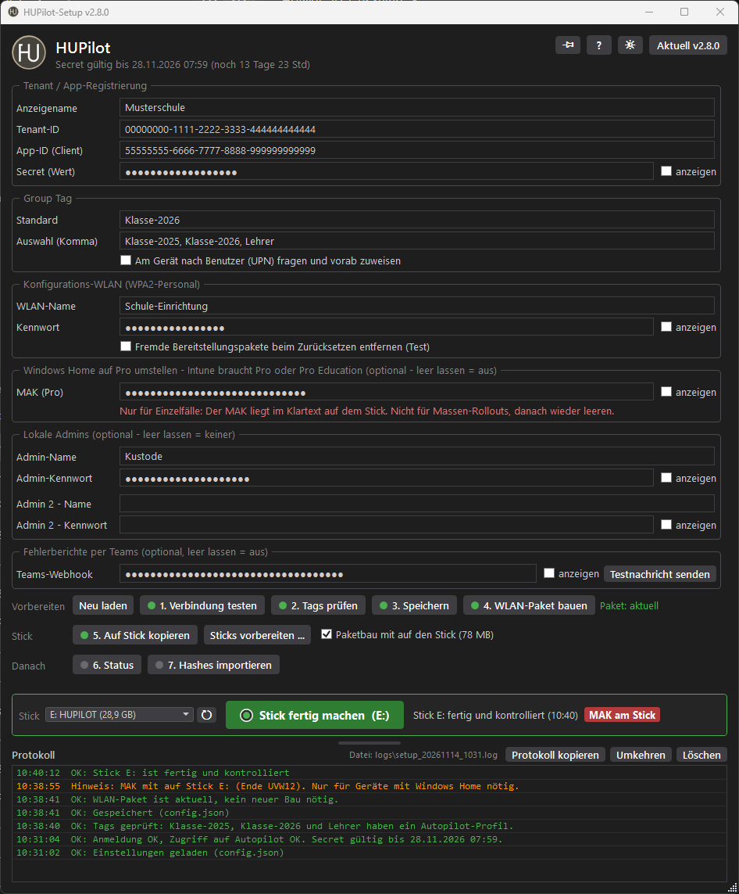
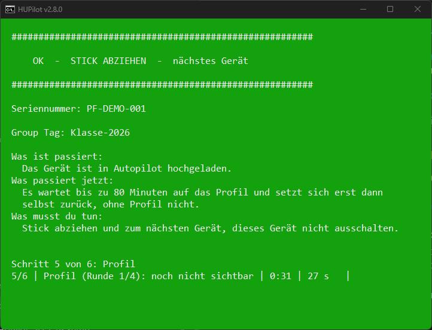
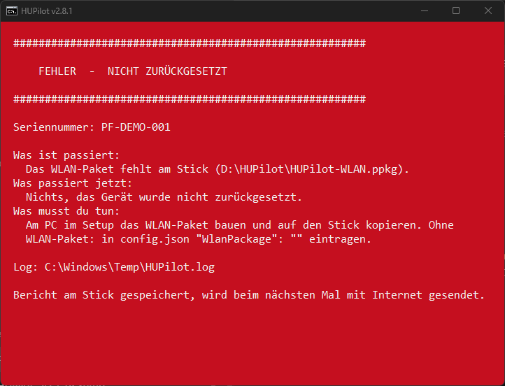
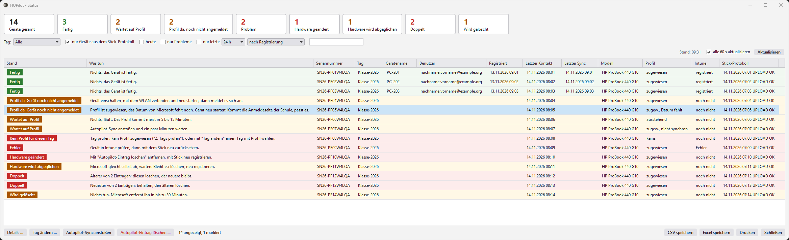
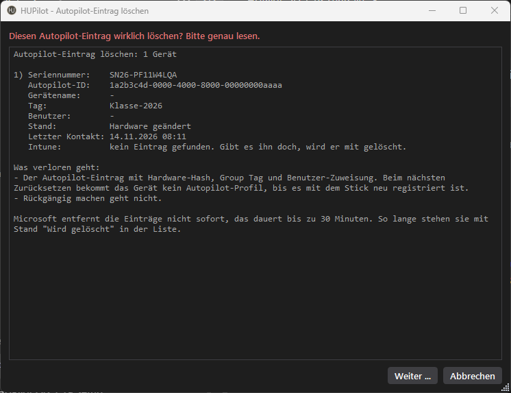
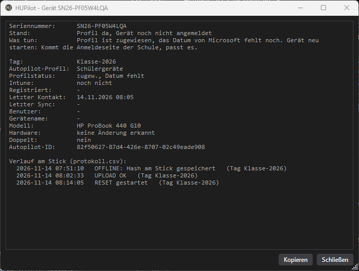
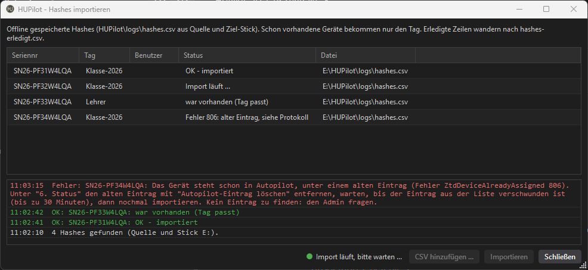
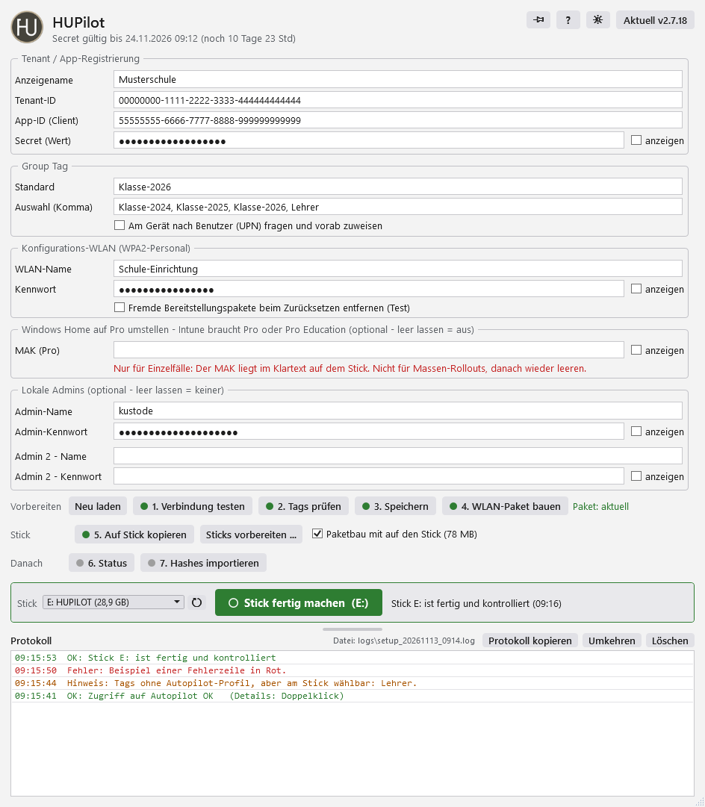

<h1 align="center"> HUPilot</h1>

<b>Windows Autopilot per USB-Stick</b> 
Hash mit Group Tag hochladen, Gerät ohne Hersteller-Programme zurücksetzen: <code>Shift+F10</code>, dann <code>D:\go</code>.

  
  
  
  

<a href="https://chiliapple.github.io/HUPilot/Stick/HUPilot/Setup/Anleitung.html"><b>Anleitung</b></a> | <a href="INSTALL.md">Installation</a> | <a href="CHANGELOG.md">Änderungen</a> | <a href="LICENSE">Lizenz</a>

---

## Ablauf am Gerät

1. Neues Gerät im ersten Einrichtungsbildschirm, Stick anstecken, **Shift+F10**, dann `D:\go` (das Fenster öffnet maximiert)
2. go prüft zuerst Einstellungen, Seriennummer, Windows, WLAN-Paket und Hash, dann kommen die Fragen: Tag (optional Benutzer) und "zurücksetzen ja/nein" (je 10 s, sonst Standard)
3. Zusammenfassung, danach läuft alles ohne weitere Fragen, mit "Schritt x von 6"
4. Upload, dann **grün "STICK ABZIEHEN"**, nächstes Gerät
5. Gerät wartet auf das Autopilot-Profil (ohne Profil weiter warten, höchstens 80 Minuten) und setzt sich selbst zurück, danach Autopilot-Anmeldung

Jedes Ende zeigt drei Sätze: was passiert ist, was jetzt passiert und was zu tun ist.

 

| Farbe | Bedeutung |
|---|---|
| Grün | Upload fertig, Stick abziehen |
| Gelb | Netzteil fehlt, kein Profil für den Tag, noch kein Profil (weiter warten), **Hash gespeichert** (offline, später am PC hochladen) |
| Blau | Zurücksetzen startet, Windows wird auf Pro umgestellt |
| Rot | Fehler, **nichts** zurückgesetzt. Ursache und nächster Schritt stehen am Bildschirm. Diagnose zum Abfotografieren: `D:\diag`. Mit eingetragenem Teams-Webhook geht ein Bericht an den Admin, ohne Internet bleibt er am Stick und wird später gesendet |

## Vorbereitung

1. App-Registrierung `HUPilot-Upload`, siehe [INSTALL.md](INSTALL.md)
2. `Stick\` auf Stick oder in einen Ordner kopieren, **`HUPilot-Setup.cmd`** starten, Felder ausfüllen
3. Stick anstecken, auswählen und **Stick fertig machen** klicken: prüft Eingaben, Verbindung, Secret und Tags, speichert, baut das WLAN-Paket wenn nötig, kopiert und kontrolliert den Stick. Die Einzelschritte 1 bis 7 gibt es weiterhin, jeder mit Ampel.
4. Danach *6. Status* (Stand jedes Geräts in Klartext, mit "Was tun") und ggf. *7. Hashes importieren*

Neben dem Hauptknopf steht rot **MAK am Stick**, wenn auf dem gewählten Stick ein MAK im Klartext liegt. Ist das Secret abgelaufen, zeigt das Setup einen roten Hinweis mit dem Knopf *Neues Secret anlegen*.

### Status

Kacheln und Zeilen zeigen jeden Stand: Fertig, Wartet auf Profil, Profil da (noch nicht angemeldet), Kein Profil für diesen Tag, Fehler, Hardware geändert, Hardware wird abgeglichen, Doppelt und Wird gelöscht. Klick auf eine Kachel filtert. Dazu Details, Tag ändern, Autopilot-Sync anstoßen, CSV, Excel und Drucken.

**Autopilot-Eintrag löschen** (z. B. nach einem Mainboardtausch oder bei doppelten Einträgen): höchstens 5 Geräte, erste Abfrage zeigt, was gelöscht wird und was verloren geht, die zweite verlangt die Seriennummer (bei mehreren Geräten `LÖSCHEN`) getippt. Danach steht das Gerät mit "Wird gelöscht" in der Liste, bis Microsoft den Eintrag entfernt hat (bis zu 30 Minuten).

 

**7. Hashes importieren** lädt offline gespeicherte Hashes hoch. Importfehler 806 (schon unter einem alten Eintrag in Autopilot) und 808 (anderer Organisation zugeordnet) stehen in Klartext mit dem nächsten Schritt da.

Die Oberfläche gibt es dunkel und hell, umschaltbar mit dem Knopf oben rechts.

> **Status:** in Erprobung. Upload, Tag-Wechsel, Tag-Prüfung, Offline-Hashes, Zurücksetzen (auch im Akkubetrieb), WLAN-Paket und Autopilot laufen. **Noch nicht auf einem unberührten Neugerät bestätigt:** dass nach dem Zurücksetzen keine Hersteller-Programme zurückkommen.

## Gut zu wissen

- Zurücksetzen ohne Hersteller-Programme: `C:\Recovery\Customizations` wird weggeschoben, dann *Alles entfernen* (RemoteWipe `doWipePersistProvisionedData`). Hersteller-Store-Apps kann Windows trotzdem wiederherstellen.
- **Kein CleanPC-Paket verwenden:** Windows wendet gespeicherte Pakete nach jedem Zurücksetzen erneut an (Endlosschleife).
- Optional bis zu zwei lokale Admins, z. B. Kustode und Elternverein (Kennwort und Konto laufen nie ab), kommen mit dem WLAN-Paket. Das Setup zeigt, ob das Paket noch zu WLAN und Admins passt. Sperrt Intune Bereitstellungspakete (`AllowAddProvisioningPackage`), bleibt am eingerichteten Gerät das vorhandene Paket.
- Kein Internet oder Secret abgelaufen: der Hash wird am Stick gespeichert und später im Setup hochgeladen. Die Uhrzeit stellt go selbst. Das Setup warnt beim Kopieren, wenn das Secret abgelaufen ist oder bald abläuft.
- Fehlerberichte per Teams (optional): Adresse eines Teams-Workflows im Setup bei *Teams-Webhook* eintragen, *Testnachricht senden*. go schickt bei Rot einen Bericht mit dem Log dieses Laufs, im Setup schickt Rechtsklick im Protokoll, *An Admin senden* eine Zeile mit Details. Die Adresse liegt im Klartext am Stick, Berichte können Seriennummer, Gerätename, Benutzer- und WLAN-Namen enthalten: Kanal nur für die Admins.
- Das Setup schreibt ein Protokoll je Sitzung nach `HUPilot\logs` (ohne Secret, Kennwörter und Schlüssel).
- Setup prüft beim Start online auf neue Versionen (Knopf *Update*, gold = neu). Updates kommen als GitHub-Release mit Prüfsumme und Signatur des Herausgebers und werden erst nach Freigabe angeboten (Kanal *Stabil*, *Test* per Rechtsklick).
- Schutz: Gerät mit Benutzerprofil: rote Rückfrage. Ohne Netzteil und unter 50 % Akku: wartet.
- Secret kurz gültig halten, Stick nicht aus der Hand geben (`DeviceManagementServiceConfig.ReadWrite.All` gibt es nur mit Schreibrecht).

---

**Lizenz:** kostenlose Nutzung erlaubt, Veränderung und Weitergabe veränderter Fassungen nicht, siehe [LICENSE](LICENSE).
